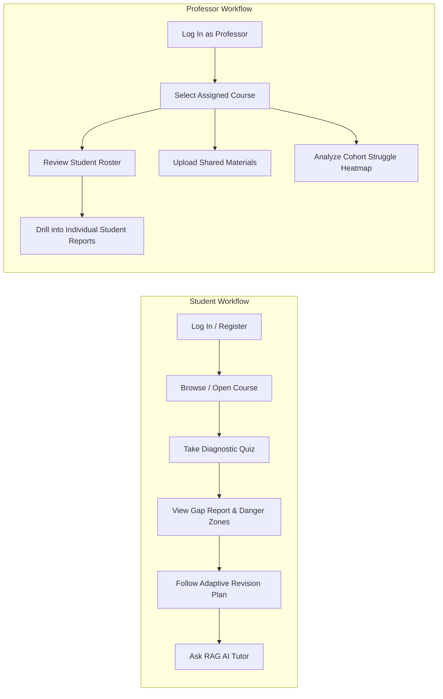

# 🎯 GapFinder AI
### Proactive Knowledge Gap Diagnosis & Adaptive Revision Platform for Students & Educators

[](https://nextjs.org/)
[](https://react.dev/)
[](https://www.typescriptlang.org/)
[](https://tailwindcss.com/)
[](https://supabase.com/)
[](https://ai.google.dev/)

> **"Find What You Don't Know. Fix It Before Your Exam."**
>
> *GapFinder AI analyzes your course materials, identifies your weak topics and misconceptions through grounded diagnostic testing, and builds a personalized, time-budgeted revision plan to help you study smarter.*

---

## 📋 Table of Contents
1. [Problem Statement & Objectives](#-problem-statement--objectives)
2. [Demo Login Credentials for Evaluators](#-demo-login-credentials-for-evaluators)
3. [Key Features](#-key-features)
4. [Technology Stack](#-technology-stack)
5. [User Workflows: Student vs. Professor](#-user-workflows)
6. [System Architecture & RAG Pipeline](#-system-architecture--rag-pipeline)
7. [Preloaded Courses](#-preloaded-courses)
8. [Project Directory Structure](#-project-directory-structure)
9. [Prerequisites & Installation](#-prerequisites--installation)
10. [Environment Variables & Supabase Setup](#-environment-variables--supabase-setup)
11. [Run, Test & Build Commands](#-run-test--build-commands)
12. [Screenshots & Visual Tour](#-screenshots--visual-tour)
13. [Security & Privacy Architecture](#-security--privacy-architecture)
14. [Limitations & Roadmap](#-limitations--roadmap)
15. [Contributing & License](#-contributing--license)

---

## 💡 Problem Statement & Objectives

### The Problem
Traditional exam preparation tools are reactive: they wait for the student to ask a question. However, **students cannot ask about a gap they do not know they have**. Most students review notes linearly, spending equal time on concepts they already understand while overlooking subtle misconceptions that lead to exam failures.

### The Objective
GapFinder AI reverses this paradigm into a **proactive diagnostic learning engine**:
1. **Curriculum Grounding**: Ingests textbooks, notes, syllabi, and past exam papers.
2. **Diagnostic Assessment**: Questions are grounded in source notes with distractor choices designed to capture specific cognitive misconceptions.
3. **Multi-Dimensional Gap Diagnosis**: Computes mastery across theoretical principles, problem-solving derivations, edge cases, and terminology.
4. **Adaptive Scheduling**: Formulates day-by-day revision checklists prioritized by exam weightage and student weak points.
5. **Teacher Analytics**: Aggregates cohort performance so professors can pinpoint class-wide struggle topics before exams.

---

## 🔑 Demo Login Credentials for Evaluators

GapFinder AI comes pre-seeded with complete benchmark data across 3 courses and 3 accounts for immediate demonstration and evaluation.

### Accounts Roster

| Role | Name | Email | Password | Assigned / Enrolled Courses |
|---|---|---|---|---|
| **Professor** | **Dr. Sarah Williams** | `prof.sarah@gapfinder.demo` | `Professor@123` | **CS201**, **CS202**, **CS301** (All courses) |
| **Student 1** | **Alex Chen** | `alex.chen@gapfinder.demo` | `Student@123` | **CS201** (OS) & **CS202** (DBMS) |
| **Student 2** | **Priya Sharma** | `priya.sharma@gapfinder.demo` | `Student@123` | **CS201** (OS) & **CS301** (ML) |

### Step-by-Step Evaluator Instructions:
1. Start the local server (`npm run dev`) and navigate to `http://localhost:3000`.
2. On the **Landing Page**, review the platform highlights.
3. Click either the **1-Click Demo Login cards** on the banner or click **"Log In"** / **"Continue as Student"** / **"Continue as Professor"**.
4. **As Alex Chen (Student 1)**:
   - Notice enrolled courses (**CS201 Operating Systems** and **CS202 Database Systems**).
   - In the course catalog, see that **CS301** is available for enrollment.
   - Switch to CS202, take the **Diagnostic Quiz**, submit your answers, and view the **Diagnostic Gap Report**.
   - Check the **Personalized Revision Plan** and interactively tick completed revision tasks.
5. **As Priya Sharma (Student 2)**:
   - Switch users using the top-bar fast account switcher.
   - Confirm her enrolled courses are **CS201** and **CS301**. Notice that Alex's CS202 quiz attempts and revision plan are completely isolated and private.
6. **As Dr. Sarah Williams (Professor)**:
   - Switch to Dr. Sarah Williams.
   - Explore the **Professor Management Workspace**: view the student roster for CS201 (showing both Alex and Priya), click an individual student to inspect their detailed diagnostic gap report, review syllabus coverage, and examine the class-level struggle heatmap.

> [!WARNING]
> **Demo-Only Notice**: These accounts are provided strictly for demonstration and evaluation. They contain synthetic benchmark course notes and mock data. Evaluators and testers should never store real credentials or private personal information in demo accounts.

---

## 🚀 Key Features

- **Hierarchical Topic Map**: Interactive syllabus visualization with unit groupings, exam weightage badges, and honest evidence labels (`HIGH_EVIDENCE`, `LIMITED_EVIDENCE`, `UNTESTED`).
- **Grounded Diagnostic Quiz**: Questions reference verbatim source chunks and provide source citations with document names, section headers, and page numbers.
- **Misconception Trap Classification**: Differentiates between random mistakes and deep conceptual confusion based on student distractors.
- **Multi-Dimensional Gap Diagnosis**: Evaluates mastery across Theory, Problem Solving, Edge Cases, and Terminology, while flagging **High-Risk Danger Zones**.
- **Personalized Revision Scheduler**: Formulates a structured day-by-day revision checklist prioritized by exam weightage and remaining study hours, with Markdown export.
- **Grounded RAG Assistant**: Answers conceptual queries with source citations and offers deterministic BM25/TF-IDF fallback when external AI services are unconfigured.
- **Course Catalog & Self-Enrollment**: Students can browse all departmental offerings and self-enroll in additional courses.
- **Professor Workspace & Roster Inspection**: Teachers can manage courses, review enrolled students, inspect individual reports, and analyze cohort heatmaps.
- **Dual-Mode Persistence**: Seamlessly operates in resilient local mode or synchronizes with cloud Supabase PostgreSQL and pgvector.

---

## 🛠️ Technology Stack

| Layer | Technologies | Verification Details |
|---|---|---|
| **Frontend Framework** | **Next.js 16.4.3 (Turbopack)** | App Router, Server Components & Client Boundaries |
| **UI Library** | **React 19.3** | Functional components, custom hooks, `useMemo` optimization |
| **Language** | **TypeScript 5** | Strict type-safety across all entities in `src/types/index.ts` |
| **Styling** | **Tailwind CSS 4** | Responsive design, dark mode tokens, accessible typography |
| **Database & Vector** | **Supabase / PostgreSQL (pgvector)** | HNSW vector indexing, `match_chunks` RPC, Row Level Security |
| **AI / LLM** | **Google Gemini SDK** | `gemini-1.5-flash` / `gemini-2.0-flash` with local BM25 fallback |
| **Icons & Design** | **Lucide React** | Clean, accessible SVG iconography |

---

## 👥 User Workflows



---

## 📚 Preloaded Courses

The platform includes three complete benchmark academic curricula:

1. **`CS201: Operating Systems & Concurrency`**
   - **Topics:** Process Management, CPU Scheduling, Process Synchronization, Deadlocks, Memory Management, Virtual Memory, File Systems.
   - **Assigned Professor:** Dr. Sarah Williams.
2. **`CS202: Database Management Systems`**
   - **Topics:** Database Fundamentals, ER Models, Relational Model & Keys, SQL DDL/DML, Functional Dependencies & Attribute Closure, Normalization (1NF, 2NF, 3NF, BCNF), Transactions & ACID, Concurrency Control (2PL), Database Recovery & Write-Ahead Logging (WAL).
   - **Assigned Professor:** Dr. Sarah Williams.
3. **`CS301: Machine Learning Fundamentals`**
   - **Topics:** Introduction to ML, Supervised/Unsupervised Learning, Linear Regression, Logistic Regression, Decision Trees, Model Evaluation, Overfitting & Regularization, Clustering, Neural Networks.
   - **Assigned Professor:** Dr. Sarah Williams.

---

## 📁 Project Directory Structure

```
Hack-0n/
├── docs/                             # Technical documentation
│   ├── ARCHITECTURE.md               # System components & Mermaid architecture
│   ├── SETUP.md                      # Detailed installation and setup guide
│   └── SECURITY.md                   # Security model, RBAC & RLS policies
├── src/
│   ├── app/                          # Next.js App Router
│   │   ├── api/                      # Serverless API routes
│   │   │   ├── diagnostic-quiz/      # Grounded quiz generator endpoint
│   │   │   ├── evaluate-quiz/        # Diagnostic evaluation & gap report API
│   │   │   ├── explain-topic/        # RAG topic assistant endpoint
│   │   │   └── generate-plan/        # Adaptive revision plan generator API
│   │   ├── globals.css               # Global styling and Tailwind setup
│   │   ├── layout.tsx                # Root layout with theme synchronization
│   │   └── page.tsx                  # Dynamic root page (Landing / Student / Professor)
│   ├── components/                   # React UI Components
│   │   ├── AuthModal.tsx             # Role-based login and registration modal
│   │   ├── DiagnosticQuiz.tsx        # Grounded multi-choice quiz with citations
│   │   ├── ExplainAssistant.tsx      # RAG assistant with citation pills
│   │   ├── GapReportView.tsx         # Multi-dimensional diagnosis and danger zones
│   │   ├── LandingPage.tsx           # Entry hero, feature highlights & demo cards
│   │   ├── MaterialUploadModal.tsx   # Document ingestion and chunking preview
│   │   ├── Navbar.tsx                # Navigation header and fast user switcher
│   │   ├── ProfessorDashboard.tsx    # Professor workspace and student roster inspection
│   │   ├── ProgressDashboard.tsx     # Student learning analytics & cohort heatmap
│   │   ├── RevisionPlanView.tsx      # Day-by-day checklist with Markdown export
│   │   ├── SettingsModal.tsx         # Supabase & Gemini API key configuration
│   │   ├── StudentDashboard.tsx      # Course overview, readiness & catalog enrollment
│   │   └── TopicMap.tsx              # Hierarchical syllabus tree with evidence labels
│   ├── data/
│   │   └── sampleCourses.ts          # Curricula, lecture notes, and grounded quiz banks
│   ├── lib/
│   │   ├── gapAnalyzer.ts            # Scoring algorithm and misconception classifier
│   │   ├── gemini.ts                 # Google Gemini SDK and prompt templates
│   │   ├── ragEngine.ts              # Semantic chunking and BM25 local indexer
│   │   ├── storage.ts                # Multi-user data isolation and seed manager
│   │   ├── supabase.ts               # Supabase client singleton and credential resolver
│   │   └── supabaseDb.ts             # Cloud PostgreSQL database sync operations
│   └── types/
│       └── index.ts                  # TypeScript domain models and interface contracts
├── supabase/
│   └── schema.sql                    # PostgreSQL schema, pgvector setup & RLS policies
├── .env.example                      # Template environment variables
├── CONTRIBUTING.md                   # Contribution guidelines
├── package.json                      # Project dependencies and build scripts
└── README.md                         # Main documentation
```

---

## ⚡ Prerequisites & Installation

### Prerequisites
- **Node.js**: v18.18.0 or newer (v20+ recommended)
- **npm** or **pnpm**

### Step-by-Step Installation:
```bash
# 1. Clone the repository
git clone https://github.com/abhilash-210/StudentGap-AI.git
cd StudentGap-AI

# 2. Install dependencies
npm install

# 3. Launch local development server
npm run dev
```

Open your browser at: **`http://localhost:3000`**

---

## ⚙️ Environment Variables & Supabase Setup

GapFinder AI operates 100% out-of-the-box in local demonstration mode. To link a live Supabase PostgreSQL database:

1. Copy `.env.example` to `.env.local`:
   ```bash
   cp .env.example .env.local
   ```
2. Configure your credentials in `.env.local`:
   ```env
   NEXT_PUBLIC_SUPABASE_URL=https://your-project-id.supabase.co
   NEXT_PUBLIC_SUPABASE_ANON_KEY=your-supabase-anon-key
   NEXT_PUBLIC_SUPABASE_PUBLISHABLE_KEY=your-supabase-publishable-key
   
   # Optional: For enhanced generative explanations
   GEMINI_API_KEY=your-gemini-api-key
   ```
3. Open the **SQL Editor** in your Supabase dashboard and run the entire script in [supabase/schema.sql](supabase/schema.sql).

---

## 🧪 Run, Test & Build Commands

```bash
# Start development server
npm run dev

# Run ESLint validation
npm run lint

# Build production bundle with Turbopack
npm run build

# Start production server
npm run start
```

---

## 📸 Screenshots & Visual Tour

| Section | Description |
|---|---|
| **Landing Page** | Headline, project highlights, evaluator 1-click demo login cards, and role selectors. |
| **Student Dashboard** | Readiness meter, enrolled courses, weak topic warnings, and course catalog for enrollment. |
| **Diagnostic Quiz** | Grounded multi-choice question interface with confidence selection and verbatim citations. |
| **Diagnostic Gap Report** | Cognitive mastery dimensions (Theory, Problem Solving, Edge Cases, Terms) and danger zones. |
| **Revision Planner** | Multi-day schedule prioritized by exam weightage with interactive task checkboxes. |
| **Professor Workspace** | Course management, student roster, individual student modal, and class struggle heatmap. |

---

## 🔒 Security & Privacy Architecture

- **Zero Data Exposure Before Auth**: The landing page exposes no student or teacher data.
- **Row Level Security (RLS)**: Enforced in PostgreSQL to ensure students can only view their own private study records.
- **Clean Secrets Policy**: Private keys are excluded from client bundles; local configuration is strictly ignored via `.gitignore`.
- Full details are documented in [docs/SECURITY.md](docs/SECURITY.md).

---

## 🗺️ Limitations & Roadmap

- **Scanned PDFs**: Current ingestion supports text-based PDFs, Markdown, and TXT files. Integration with OCR engines (e.g., Tesseract or Cloud Vision) is planned for handwritten notes.
- **Live Canvas/Moodle LTI**: Future releases will support direct LTI 1.3 integration for seamless university LMS synchronization.

---

## 🤝 Contributing & License

- **Contributing**: Please review [CONTRIBUTING.md](CONTRIBUTING.md) for branch naming and pull request guidelines.
- **License**: Distributed under the MIT License for educational and evaluation use.
