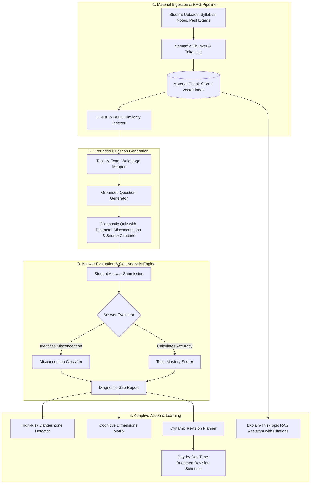
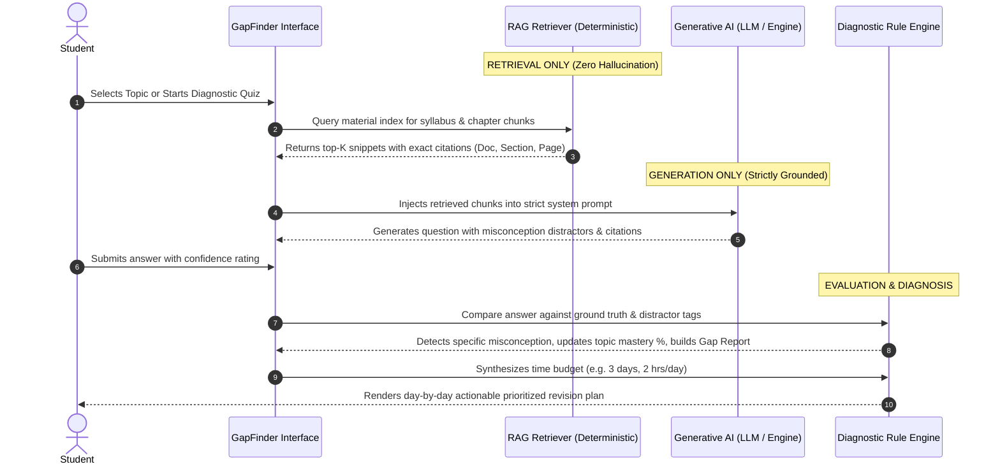

# 🎯 GapFinder AI
### Proactive Knowledge Gap Diagnosis & Adaptive Revision Engine for Students

> **"Students often study everything equally and still miss what they don’t know. Traditional study tools wait for the student to ask a question, but a student cannot ask about a gap they do not know they have."**
>
> **GapFinder AI** reverses the traditional study paradigm. Instead of an unguided generic chatbot, GapFinder AI ingests a student's syllabus, textbook chapters, lecture notes, and past question papers, finds their hidden conceptual blindspots and misconceptions through grounded diagnostic testing, and builds an adaptive, time-budgeted revision plan.

---

## 🌟 Demo Credentials & Preloaded Courses (Ready for Evaluation)

GapFinder AI comes **preloaded with complete course curricula, lecture notes, past exam questions, and baseline diagnostic reports**, allowing judges and evaluators to experience the full application in 1 click without uploading anything:

| Role | Username / Email | Password | Quick Login in UI | Key Purpose |
| :--- | :--- | :--- | :--- | :--- |
| **Demo Student** | `student@gapfinder.ai` | `demo1234` | **"Alex Chen (Student)"** | Experience student diagnosis, quiz testing, gap reports, and dynamic revision plans |
| **Demo Professor** | `prof.sarah@university.edu` | `prof1234` | **"Prof. Sarah (Teacher)"** | Inspect class-level topic struggle heatmaps and cohort misconception analytics |

### Preloaded Benchmark Courses:
1. **`CS201: Operating Systems & Concurrency`**
   - **Syllabus:** Process synchronization, Semaphores, Deadlocks & Banker's Algorithm, Virtual Memory, TLB Effective Access Time (EAT), Page Replacement (FIFO vs LRU, Belady's Anomaly), Thrashing & Working Set.
   - **Notes Chunks:** Multi-page lecture notes with mathematical formulas and pseudocode.
   - **Past Exams:** Real University & GATE past paper problem sets (2022–2024).
2. **`CS301: Machine Learning & Deep Learning Foundations`**
   - **Syllabus:** Empirical risk minimization, Gradient descent variants, L1 Lasso vs L2 Ridge geometric sparsity, Regularization, and Neural Backpropagation.

---

## 🏗️ System Architecture Overview

GapFinder AI is built with **Next.js 16 (App Router)**, **TypeScript**, and **Tailwind CSS**, powered by a **Dual-Mode AI Architecture** that pairs Retrieval-Augmented Generation (RAG) with diagnostic evaluation algorithms.



---

## 🔍 Retrieval vs. Generation: Architectural Separation

A mandatory hackathon criterion is clarity on where retrieval is used, where generation is used, and how the two are kept separate:



### 1. Where Retrieval is Used (Deterministic):
- **Chunking & Indexing:** Uploaded PDFs and text notes are broken into semantic paragraphs preserving source section headers and page references.
- **BM25 / TF-IDF Vector Retrieval:** When generating diagnostic quizzes or answering conceptual questions, the retrieval engine searches candidate chunks and extracts top-K relevant passages.
- **Source Citation Pinpointing:** Answers and questions always link directly back to the physical source chunk (`[Operating_Systems_Lecture_Notes.pdf: Section 5.4, Page 78]`).

### 2. Where Generation is Used (Bounded):
- **Misconception-Targeted Distractors:** The AI generates plausible distractors designed around real student cognitive flaws (e.g. confusing FIFO's Belady's Anomaly with LRU).
- **Personalized RAG Explanations:** When a student clicks "Explain-This-Topic", the LLM synthesizes an intuitive breakdown strictly grounded in the retrieved passages.

### 3. How They Are Kept Separate:
- The AI is never allowed to answer from ungrounded parametric memory. If the retrieval step returns insufficient relevant context, the system explicitly alerts the user and requests supplementary course notes.
- Diagnostic grading is verified against exact chunk assertions and validated distractor metadata.

---

## 🚀 Key Features

### 1. 📂 Material Upload & Topic Mapping
- Upload custom course syllabus, textbook chapters, lecture notes, or past papers in PDF, TXT, or Markdown format.
- Live RAG chunk preview and keyword indexing.
- Automatically organizes materials into an interactive **Topic Map** showing units, subtopics, key concepts, and exam weightages.

### 2. 🧪 Grounded Diagnostic Quiz
- Questions created strictly from uploaded materials—not from generic model memory.
- Every question displays an expandable **"View Source Citation"** drawer pointing to the exact document, section, and page number.
- Distractors test specific misconceptions, not just random wrong answers.
- Live timer and confidence rating selector (Low / Medium / High) to detect accidental guesses versus deeply held misconceptions.

### 3. 📊 Diagnostic Gap Report (Core Differentiator)
- **Executive Readiness Score:** Real-time percentage indicator of overall exam preparedness.
- **Topic Categorization:**
  - 🔴 **Weak Topics (<50%):** Pinpoints the precise misconception, reason for failure, and key citations to review.
  - 🟡 **Medium Topics (50–75%):** Highlights edge-case difficulties and calculation speed issues.
  - 🟢 **Strong Topics (>75%):** Confirms mastery with spaced-retrieval maintenance tips.
- **Cognitive Dimensions Matrix:** Breakdown across Theoretical Foundations, Problem Solving & Calculations, Edge Cases, and Terminology.
- **High-Risk Danger Zones:** Automatically flags high-exam-weightage topics where the student has low mastery.

### 4. 📅 Adaptive Dynamic Revision Plan
- Personalized study schedules tailored to the student's available timeframe (e.g. 2, 3, 5, 7, or 14 days) and daily study hours (1.5 to 6 hrs/day).
- Daily structured micro-tasks: *Misconception Clearing*, *Core Concept Revision*, *Past-Paper Drills*, and *Active Recall Syntheses*.
- Interactive checklist: Checking off completed tasks updates the real-time completion gauge and dynamically recalculates readiness.
- 1-Click Export to clean Markdown.

### 5. 💡 Explain-This-Topic RAG Assistant
- Conversational tutor grounded exclusively in the student's notes and past papers.
- Every response includes clickable source citations with exact snippets.
- Interactive follow-up prompts to test understanding immediately.

### 6. 📈 Progress & Teacher Cohort Analytics
- Historical trend tracking across diagnostic quiz attempts.
- **Teacher View Toggle:** Visualizes class-level topic struggle heatmaps across 48 students, demonstrating future institutional scalability for educators and LMS platforms.

---

## 🛠️ Tech Stack & Architecture

- **Frontend & App Framework:** [Next.js 16](https://nextjs.org/) (App Router, Turbopack)
- **Language:** TypeScript 5 (Strict Mode)
- **Styling:** Vanilla Tailwind CSS with modern dark slate aesthetic, glassmorphic cards, and micro-interactions
- **Icons & Visuals:** `lucide-react`, `canvas-confetti`
- **AI & RAG Layer:**
  - Google Gemini API (`@google/generative-ai` with Gemini 1.5 Flash / 2.0 Flash)
  - Resilient Local BM25/TF-IDF Vector Retrieval Fallback (Zero external dependency required for local judging)
- **State & Persistence:** LocalStorage caching + Next.js API Routes

---

## ⚡ Quick Start & Setup Instructions

### Prerequisites
- Node.js v18+ (tested on v24)
- npm or pnpm

### 1. Clone & Install Dependencies
```bash
git clone https://github.com/your-username/gapfinder-ai.git
cd gapfinder-ai
npm install
```

### 2. Configure Environment Variables (Optional)
GapFinder AI features a **Dual-Mode AI Engine**:
- **Without an API key:** The app automatically runs on its built-in resilient RAG retrieval and diagnosis engine. Everything works seamlessly out-of-the-box!
- **With Gemini API key (optional):** Enables enhanced LLM generation.
```bash
cp .env.example .env.local
```
Add your key inside `.env.local`:
```env
GEMINI_API_KEY=your_gemini_api_key_here
```
*(You can also configure the Gemini API key directly in the application UI under "AI Config" in the top bar!)*

### 3. Run Development Server
```bash
npm run dev
```
Open **[http://localhost:3000](http://localhost:3000)** in your browser.

### 4. Build for Production
```bash
npm run build
npm start
```

---

## 🚢 Deployment to Vercel

GapFinder AI is designed for single-click deployment to **Vercel**:
1. Push your repository to GitHub.
2. Import the project in the [Vercel Dashboard](https://vercel.com).
3. (Optional) Set the `GEMINI_API_KEY` environment variable in Vercel project settings.
4. Deploy! Next.js App Router will generate static and dynamic serverless endpoints automatically.

---

## 🔮 Scope, Limitations & Future Enhancements

### Current Scope:
- College and school students preparing for university midterms, end-terms, and competitive exams (e.g., GATE CS, Technical Interviews).
- Self-learners needing objective feedback on what they don't know.
- Instructors seeking topic-level diagnosis of class comprehension.

### Limitations:
- Scanned PDF images require OCR preprocessing before text extraction (currently optimized for digital PDFs, text, and markdown).
- Vector store in demo mode uses an in-memory/indexed TF-IDF embedding store; enterprise scale would connect to PostgreSQL `pgvector` or Supabase Vector.

### Future Roadmap:
- **Spaced-Repetition Reminders:** Automated push/calendar notifications scheduled at optimal forgetting-curve intervals.
- **LMS Integrations:** Direct Canvas/Blackboard/Google Classroom assignment import and gradebook sync.
- **Multi-Modal Diagrams:** Diagnostic questions based on circuit diagrams, UML class diagrams, and memory layout schematics.
- **Multi-Language Support:** Localized diagnostic testing in regional languages.

---

## 📄 License & Attribution
Developed with pride for the Placement Drive Technical Evaluation Round. All sample course materials, lecture notes, and question citations are crafted for academic demonstration.
